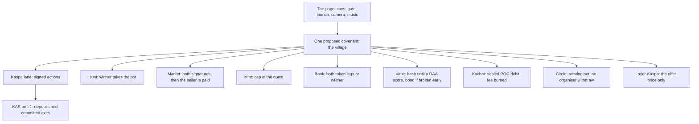

# A map: one village program

The 9 October 2026 workshop says the rollup fixes the shape and the program picks the rules. A vprog today is one covenant id, one lane, one state tree, one settlement chain, one operator. It does not call another program. Composability is a yellow paper, not code.

That sentence decides the map. A town that must swap, mint, and pay a prize in one gesture is one program. Three programs would be three operators, three stalls, and no atomic trade between them.

This file is a proposition. It does not change https://sixpack.wtf/1984.html, does not open the spend gate, and does not deploy a covenant. The lab that runs the rules is this crate. `cargo test` and `cargo run --example town`.

## Web 4.0

Web 4.0, in the 2026 writing, is the agentic web. People set goals. Agents read, pay, and call tools without a person on every step. Two public anchors from this year:

- Yat Siu, quoted on 9 October 2026, calls this era Web4 and says it is possible because digital property already exists. He expects agents to pay many times a day, and he expects sites to charge agents for a feed. [The Markets Cafe](https://themarketscafe.com/ai-agents-will-kill-the-web-as-we-know-it-animocas-yat-siu/).
- The Web4 Agent Economy paper (arXiv [2606.25876](https://arxiv.org/html/2606.25876v1), 24 August 2026) treats agents as economic actors and names MCP, x402, and EIP-8004 as the stack for tools, micropayments, and identity. It reports sub-dollar machine payments as the live pattern.

Kaspa's fit is the inbox and the money, not a new coin.

An agent signs a lane action on its own key. The lane is a public subnetwork. Nobody sequences it. The selected chain, with the mergeset folded into it, is the order. The guest checks the price, the cap, the turn, or the allowlist. KIP-16 is what lets a Kaspa node check the proof without running the guest. KIP-20 binds the pile to one covenant. KIP-21 commits the lane in the headers. The workshop states those three as live on mainnet, and the demo as testnet-10. This desk did not re-run the proofs.

The honest limit sits next to the vision. Safety and liveness are different. A committed exit cannot be withheld. A balance that is not yet a committed exit waits if every operator stops. The book ships no forced-inclusion path and no escape hatch. An agent economy that hides that stall will strand the agent's float. Print the stall next to the price.

The big version is a city of agents that hire, escrow, and split inside one program, paying KAS per call at lane speed, with the rule frozen in the image id. The version that exists is one program that can do all of that for itself and cannot yet hand a balance to the program next door.

## Industries that fit one program

These fit because the whole rule touches state the program already holds.

| Industry | The rule the guest owns | What stays outside |
| --- | --- | --- |
| Agent meter | A sealed price per tool call. Repricing after seal fails. The fee can burn so the operator does not collect it. | The tool itself. MCP or HTTP still runs off the lane. |
| Tournament and prize | Two seats lock a stake. The winner takes the pot. A draw splits it. The organiser has no withdraw. | The broadcast, the camera, the crowd. |
| Delivery escrow | The buyer locks the price. Both sides sign. Then the seller is paid. One signature pays nothing. | A brand code, a shipping API, an email. |
| Royalty | Shares are sealed in basis points and sum to 10,000. A later edit fails. The last share takes the remainder. | The song, the catalogue, the collecting society. |
| Wage | The same two-signature deal, used as completion of a job. The rate cannot move after the lock. | The work product. |
| Savings circle | Members lock an equal amount. Payout rotates. The organiser cannot take the pot. | A bank charter. This is not a deposit product. |
| Aid | A donor funds a pot and an allowlist. A payment to anyone else fails. | Identity of the people on the list. The list is public in this lab. |
| Sealed disclosure | Readers see a hash until a DAA score. The owner can always read. Breaking the seal early pays the bond to the readers. | Encryption. A real NDA, a company secret, and an intelligence file do not belong here. |
| Single book | Orders enter at the tail. A jump to the head fails. | A market that must call a lender. One book is not a trading stack. |
| Loyalty | Points mint under a cap inside one merchant. The merchant cannot mint past the cap. | A coalition of merchants. That is a second program, or a later composability. |

## Industries that wait

Lending that seizes collateral in a different program, a DEX that settles against a stablecoin program, and an agent that carries one balance across a city of apps all need the cross-covenant call the yellow paper sketches. Building them as a promise of composability repeats the mistake the book warns against: shared-state mechanisms built before the single-app proof chain have nothing to stand on.

The workaround that works today is the monolith. Put the lender and the pool in one guest if they must move together. The cost is an audit of that one guest, and a bug that pays the wrong account drains the pile through valid proofs. Pin the image id. Treat the code as the custodian.

## What other chains already taught

The practice is the lesson. The mechanism is Kaspa's.

| Practice | Where it is familiar | What Kaspa has for it |
| --- | --- | --- |
| The L1 orders the app | Ethereum based rollups. Taiko's docs say L1 validators sequence the blocks and there is no centralized sequencer. [docs.taiko.xyz](https://docs.taiko.xyz/) | The lane. Users publish ordinary transactions. There is no sequencer service. There is also no forced-inclusion path in the workshop's machine. Say so. |
| Validity, not a fraud window | zk rollups. Early optimistic rollups made you wait out a challenge period to exit. | KIP-16 checks the proof on the node. A committed exit does not wait on a challenge game. It still waits on proving, the confirmation window, and a claim. |
| The runtime belongs to the app | Solana's Sealevel runtime is the cluster's. Every program is a guest of that one runtime. | The covenant commits the guest image ids. The chain never runs the game. A bad guest is a bad custodian. |
| State in a root, coins in outputs | Fuel's predicate model and Bitcoin state commitments. The chain holds a root, not the accounts. | The state digest. This lab uses a depth-8 SHA-256 tree so one changed sompi moves the root and kills the old membership proof. The framework tree is the real one. |
| An exit is a leaf you can claim | Ark virtual outputs, Lightning commitment transactions. | The workshop's permission tree: a leaf, a deduct, up to eight coins from the pile, fee from the claimer's own coin. This lab models the leaf and the wait for settlement. It does not model the script or the dust. |
| A sovereign app settles somewhere else | Celestia sovereign rollups put data on one chain and settlement on another. | KIP-21 puts the lane commitment in Kaspa headers. Old block bodies still need an archival peer. Name that peer. |
| The user, not a bundler, is the authority | ERC-4337 account abstraction sends a user operation through a bundler. [EIP-4337](https://eips.ethereum.org/EIPS/eip-4337) | The agent signs locally and publishes to the lane. The operator reads the lane. The operator does not admit the action. |
| Pay per request | x402 turns HTTP 402 into a machine payment. A request with no payment gets 402, and the client pays and retries. [x402.org](https://x402.org/) | A plain KAS payment is the rail. A meter program adds the rule a payment alone does not have: the price was sealed, and a later reprice fails. |

## LUMBRIDGE

The square already has the desks. The ledger behind them is the page. The spend gate is shut. KCC-20 is not Final. POC and KUSDT on the square are tags in that ledger, not covenants.

| Desk today | What would move | What would not |
| --- | --- | --- |
| Hunt | The prize. The organiser cannot withdraw. This is the book's game with a different board. | The road, the animation, the crowd. |
| Mara's Market | The lock and the two signatures. The seller is paid from the lock. | An Amazon, Steam, Netflix, PlayStation, or Uber Eats code. The page already does not email one. A proof cannot mint one. |
| Mint | The cap and the supply. Cap 0 stays open. A mint past a cap above 0 fails. A second address can mint into a name someone else opened, if that rule is kept. | A claim that this is KCC-20. It is not. The miner fee is still KAS. |
| Bank | POC against KUSDT inside the one program. A short leg rolls both back. | A swap against a program that is not this covenant. |
| Vault | The open score and the reader list, plus a bond if the owner breaks the seal early. | Encryption. The note in this lab is still visible to the program. A real NDA does not go here. The page already says that. |
| Kachat | The 0.01 POC debit, as a sealed price. This lab burns it so the desk cannot collect a fee it did not seal. | A `ciph_msg` payload, an encryption claim, the chain app at kachat.app. |
| Layer-Kaspa | The offer price, paid inside the village. | The page body. That stays on the KNS index. This desk still does not register the name. |
| Launch, gate, music, the square itself | Nothing. There is no pot. | Leave them on the page. |

Phasing, if a real guest is ever built:

1. Leave the page as it is.
2. The first guest is the hunt pot alone. It is the smallest rule that matches the workshop, and it can stand while the rest of the town stays on the desk.
3. The village monolith comes when the mint, the bank, the market, and the chat must move in one state. One operator. The card names who runs it and what waits if they stop.
4. A second covenant is a second town. `pay_across` stays a refusal until cross-covenant calls exist as code.

Project Staghunt's words, used narrowly: coordinated atomicity is the swap and the two-signature deal inside this one program. Accumulation opacity, capital multiplexing, and composability across programs are not in this lab and are not in the workshop's shipped shape.
